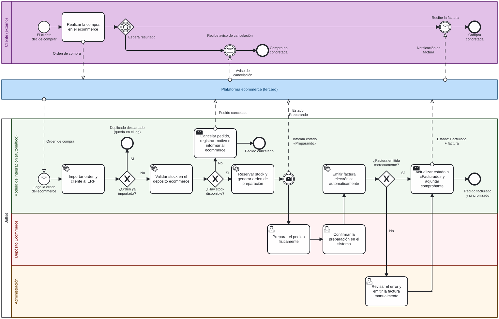

# Julliet · Integración Ecommerce ↔ ERP

> Trabajo Práctico Integrador — **Organización Empresarial**
> Tecnicatura Universitaria en Programación (a distancia) · UTN · Entrega N.º 4

## Descripción del sistema

**Julliet** es una empresa de indumentaria femenina con un local en la Ciudad Autónoma de Buenos Aires y una tienda online (ecommerce). Este proyecto propone un **módulo de integración entre el ecommerce y el ERP** de la empresa.

El módulo automatiza el recorrido de una compra online: importa las órdenes al ERP evitando duplicados, valida y reserva stock, deriva el pedido al Depósito Ecommerce para su preparación, emite la factura y comunica el estado final a la plataforma y a la clienta. Los desvíos (orden duplicada, falta de stock, error de facturación) se resuelven con caminos de excepción y quedan registrados en un **Registro de Sincronización**.

## Integrantes

| Integrante | Rol |
|---|---|
| Matías Ariel De Bonis | Trabajo individual: análisis, diseño y documentación |

**Docente:** Gabriela Martínez · **Tutora:** Laureana Gangge

## Contenido del repositorio

| Carpeta / archivo | Qué contiene |
|---|---|
| [`docs/bpmn/`](docs/bpmn) | Diagrama BPMN del proceso (`.bpmn` editable e imagen `.svg`) |
| [`docs/historias-usuario/historias-de-usuario.md`](docs/historias-usuario/historias-de-usuario.md) | Las tres historias de usuario con criterios de aceptación |
| [`docs/indicadores-control.md`](docs/indicadores-control.md) | Indicadores (KPIs) de control del proyecto |
| [`docs/declaracion-uso-ia.md`](docs/declaracion-uso-ia.md) | Declaración de uso de IA |
| [`docs/entregas/`](docs/entregas) | Documento consolidado del TPI (Entregas 1 a 4) en PDF |

## Proceso modelado (BPMN)

- **Pools:** Cliente, Plataforma ecommerce y Julliet.
- **Lanes de Julliet:** Módulo de integración, Depósito Ecommerce y Administración.
- **Compuertas de excepción:** ¿orden ya importada?, ¿hay stock disponible?, ¿factura emitida correctamente?

## Gestión del trabajo

El avance se gestiona en un tablero de **GitHub Projects** con las columnas *Por Hacer*, *En Progreso* y *Listo*. Cada historia de usuario es una tarjeta (issue) vinculada al tablero.

- Tablero: _(agregar enlace)_

## Flujo de trabajo con Git

- `main`: versión estable.
- Una rama por tarea (`docs/...`, `feature/...`), integrada a `main` mediante **Pull Request**.
- Commits descriptivos, en imperativo y en español.
- **Revisión de los Pull Requests:** por tratarse de un trabajo individual, la revisión fue realizada por el propio autor (autorrevisión). Los comentarios técnicos y la checklist de control quedan documentados en cada PR.

## Indicadores de control

Resumen (detalle en [`docs/indicadores-control.md`](docs/indicadores-control.md)):

| Indicador | Meta |
|---|---|
| Operaciones sin intervención manual | ≥ 98 % |
| Actualizaciones de stock en menos de 60 s | ≥ 95 % |
| Ventas del ecommerce sincronizadas con el ERP | ≥ 95 % |
| Cumplimiento del plazo del proyecto | ≤ 12 semanas |

## Declaración de uso de IA

**Herramienta:** Claude (Anthropic), utilizado como herramienta de apoyo durante la elaboración de la Entrega N.º 4.

**Para qué se usó**
1. Asistir en la elaboración del diagrama BPMN (generación de un primer borrador y de su representación gráfica), tomando como base el flujo definido en las Entregas 1 a 3.
2. Colaborar en la redacción y revisión de las historias de usuario y los indicadores de control.
3. Brindar orientación para organizar la estructura del README y documentar los comandos de Git.

**Prompts principales y justificación**

| Prompt (resumen) | Por qué se pidió |
|---|---|
| Solicitar asistencia para representar el proceso en BPMN con pools y lanes (Cliente, Plataforma ecommerce y Julliet con tres carriles) y compuertas para las excepciones. | Verificar que el modelo contemplara el flujo estándar y las excepciones requeridas por la consigna. |
| Solicitar sugerencias para formular tres historias de usuario en formato «Como… quiero… para…» con criterios de aceptación. | Contar con apoyo para estructurar las historias según el formato solicitado. |
| Consultar posibles indicadores alineados con las metas de la Entrega 2. | Revisar la coherencia entre los indicadores y las metas previamente definidas. |

**Correcciones humanas**
- Se revisaron y adaptaron las sugerencias proporcionadas por la herramienta para mantener la coherencia con el trabajo desarrollado en las entregas anteriores.
- El diagrama se revisó y ajustó manualmente en bpmn.io: se respetaron las convenciones de la cátedra (pregunta junto a cada compuerta exclusiva, todas sus salidas nombradas, compuerta por eventos sin nombre) y se modificó la presentación visual (por ejemplo, los colores de los carriles).
- Las historias de usuario y los criterios de aceptación se revisaron en función del proceso analizado.
- Las metas de los indicadores se verificaron contra la Entrega 2.

**Responsabilidad:** la inteligencia artificial se utilizó como herramienta de apoyo, consulta y corrección durante el desarrollo del trabajo. El contenido fue revisado y validado por el autor, que asume la responsabilidad del trabajo presentado.
